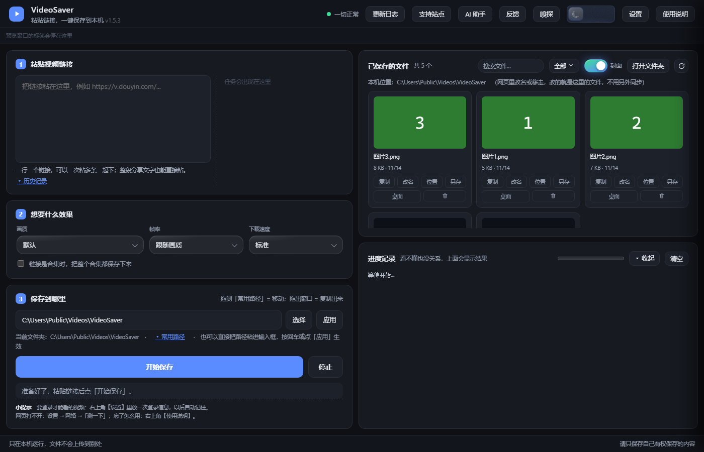

# VideoSaver

**粘贴链接，一键保存到本机。** 一个本地优先的桌面视频下载器，带 AI 助手、媒体嗅探、文件管理和预览。



[](https://github.com/lertone/VideoSaver/actions/workflows/build-all.yml)


---

## 功能

- **多站点下载**：底层 yt-dlp，自带 1600+ 提取器；B 站、YouTube、微博、小红书、快手等。
- **抖音 / TikTok**：接自建 DTK 解析服务，拿无水印直链（不内置公共解析服务）。
- **AI 助手**：用自己的 API Key（智谱 / DeepSeek / 阿里百炼 / OpenAI 兼容），能查文件、改设置、找片、下载、剪辑、抽音频、清理残留。
- **媒体嗅探**：内置侧栏，调用 Edge/Chrome 的调试协议抓取网页里的 `mp4 / m3u8 / mpd` 地址，点一下丢回下载。
- **文件管理**：搜索、分类、封面开关、点击预览、图片左右翻页、拖拽多选、批量改名/移动/删除、复制到剪贴板。
- **本地优先**：配置、登录信息、下载文件都在本机；没有账号体系，没有遥测。
- **主题**：月亮 / 太阳两套玻璃主题，经典主题保留。

## 下载安装

### Windows

到 [Releases](https://github.com/lertone/VideoSaver/releases) 下载 `VideoSaver-Setup-x.y.z.exe`，双击安装。
也可以下载绿色包解压后直接运行 `VideoSaver.exe`。

### macOS / Linux

PyInstaller 不支持交叉编译，mac/Linux 包由 GitHub Actions 在对应系统上构建：

1. 打开 [build-all](https://github.com/lertone/VideoSaver/actions/workflows/build-all.yml)；
2. 点 **Run workflow**；
3. 跑完在 artifact 里下载：
   - `VideoSaver-macos-arm64`（zip，内含 `VideoSaver.app`）
   - `VideoSaver-linux-x64`（tar.gz）

macOS 未签名版本首次打开会被 Gatekeeper 拦：右键 → 打开，或

```bash
xattr -dr com.apple.quarantine VideoSaver.app
```

## 从源码运行

需要 Python 3.12。

```bash
git clone https://github.com/lertone/VideoSaver.git
cd VideoSaver
python -m pip install -r requirements-build.txt
python tools/fetch_bin.py        # 下载当前系统的 yt-dlp / ffmpeg / N_m3u8DL-RE
python app_entry.py              # 或 python launch.py（Windows）
```

> `python build_exe.py` 这类命令必须在**项目目录**里执行，不要在 `C:\Users\你的用户名` 下执行。

## 打包

### Windows（安装包 + 绿色包）

```powershell
cd VideoSaver
python build_exe.py
python build_installer.py --version 1.5.3
```

产物：`installer_out/VideoSaver-Setup-1.5.3.exe`、`dist/VideoSaver-1.5.3.zip`。

### macOS / Linux

```bash
pip install -r requirements-build.txt
python tools/fetch_bin.py
python build_app.py
```

产物在 `release/`。Linux 需要 WebKitGTK：

```bash
sudo apt-get install -y libgirepository1.0-dev libcairo2-dev pkg-config \
  python3-gi gir1.2-webkit2-4.0
```

更细的适配矩阵、已知限制见 [PORTABILITY.md](PORTABILITY.md)。

## 配置

### AI 助手

设置 → AI 助手，填供应商的 Base URL、模型名和 API Key。Key 只存本机配置文件，界面和日志都会打码。

### 抖音解析

抖音分享页有设备指纹，本地算不出签名。需要自建
[DTK](https://github.com/Evil0ctal/Douyin_TikTok_Download_API)，在设置 → 抖音解析服务里填地址和 API Key。
没有服务时其它网站不受影响。

### 反馈中继（可选）

开源仓库**不含**任何私人中继地址或 token。本地构建时复制：

```bash
cp private_config.example.py private_config.py
```

填入你的反馈中继地址和 token。`private_config.py` 已在 `.gitignore`，不会被提交。
没有这个文件时，反馈功能会退回本机 SMTP / 未配置状态。

## 隐私

- 下载文件、配置、Cookie 都只在本机。
- 没有账号、没有统计上报。
- 反馈是用户主动点击才发送；内容只有反馈文字、版本和系统类型。
- 仓库不包含任何人的 SMTP 授权码、管理员 token、Cookie、日志或下载记录。

## 已知限制

- **DRM 内容不支持**：腾讯/优酷会员片、Netflix 等是 Widevine/ChinaDRM 加密，本工具不绕过 DRM。
- **腾讯免费片**可能被 CDN 按 IP 限速；程序会自动换线路/降档，仍不行就只能换网络。
- **抖音/快手**依赖自建解析服务，单靠 Cookie 不够。
- **macOS** 首版未做签名/公证；**Linux** 首版没有托盘，剪贴板复制文件仅 Windows 支持。

## 免责声明

本工具仅用于下载你有权保存的内容。请遵守目标网站的服务条款和当地法律，不要用于二次分发、商业盗用或规避付费墙。

## License

[MIT](LICENSE)
