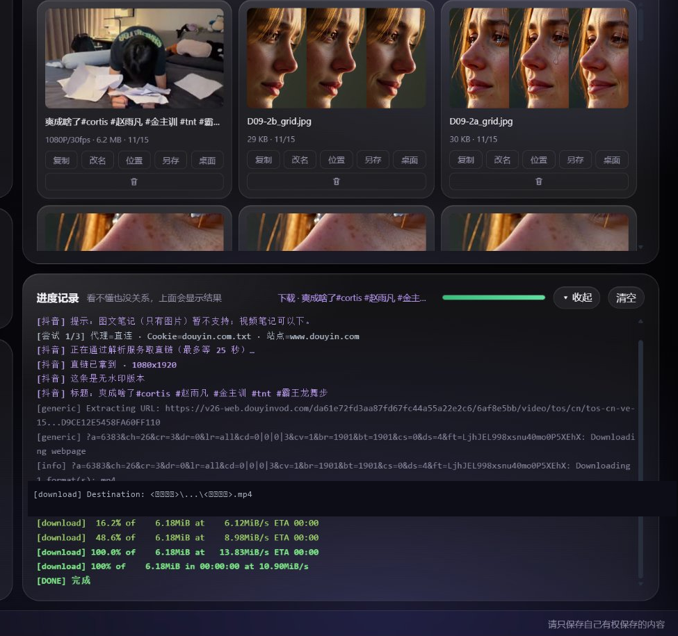
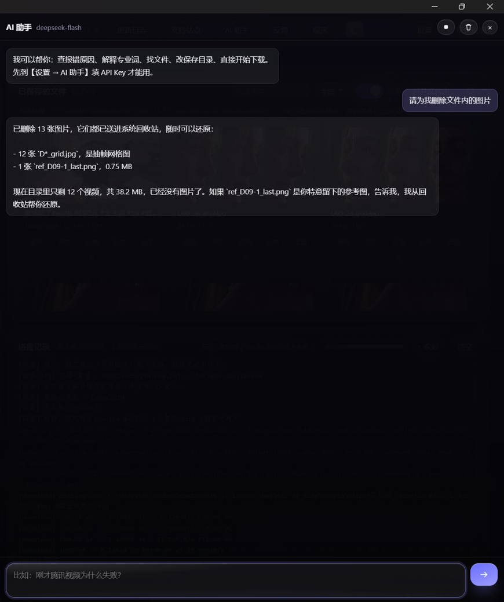
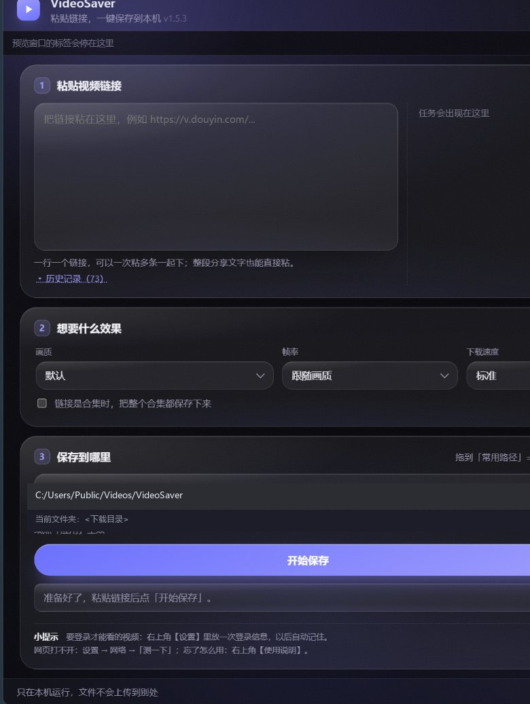

<p align="center">
  
</p>

<h1 align="center">VideoSaver</h1>

<p align="center">
  粘贴链接，一键保存到本机。<br>
  本地优先的桌面视频下载器：yt-dlp + AI 助手 + 媒体嗅探 + 文件管理。
</p>

<p align="center">
  <a href="https://github.com/lertone/VideoSaver/actions/workflows/build-all.yml"></a>
  
  
  
</p>


---

## 它是什么

VideoSaver 是一个跑在你本机的视频下载与整理工具。粘贴链接、选画质、点开始，文件就落到你的文件夹里；
下载完还能预览、改名、移动、复制，或者直接让 AI 助手帮你处理。

没有账号、没有云端、没有遥测。配置文件、登录信息、下载记录都在你自己的电脑上。

## 实例如图

<p align="center">
  
  &nbsp;&nbsp;
  
</p>

<p align="center"><sub>下载进程和 AI 助手实例如图</sub></p>

## 功能

| 能力 | 说明 |
|---|---|
| 多站点下载 | 底层 yt-dlp，自带 1600+ 提取器：B 站、YouTube、微博、小红书、快手等 |
| 抖音 / TikTok | 接自建 DTK 解析服务，拿无水印直链；不内置公共解析服务 |
| AI 助手 | 用自己的 API Key（智谱 / DeepSeek / 阿里百炼 / OpenAI 兼容），能查文件、改设置、找片、下载、剪辑、抽音频、清理残留 |
| 媒体嗅探 | 侧栏调用 Edge/Chrome 的调试协议，抓网页里的 `mp4 / m3u8 / mpd`，点一下丢回下载 |
| 文件管理 | 搜索、分类、封面开关、点击预览、图片左右翻页、拖拽多选、批量改名 / 移动 / 删除、复制到剪贴板 |
| 进度与续传 | 实时速度 / 百分比 / 剩余时间，失败自动重试，中断残片可一键清理 |
| 本地优先 | 配置、Cookie、日志、下载文件都在本机；没有账号体系，没有统计上报 |
| 主题 | 月亮 / 太阳两套玻璃主题，经典主题保留 |

## 下载

到 [Releases](https://github.com/lertone/VideoSaver/releases) 下载对应系统的包。

| 系统 | 文件 | 说明 |
|---|---|---|
| Windows | `VideoSaver-Setup-x.y.z.exe` | **安装版**：桌面窗口，带开始菜单 / 桌面快捷方式 |
| Windows | `VideoSaver-x.y.z-windows-x64.zip` | **便携版 / 网页版**：免安装，解压即用 |
| macOS（Apple Silicon） | `VideoSaver-x.y.z-macos-arm64.dmg` | 打开 dmg，把 `VideoSaver` 拖进 `Applications` |
| Linux x64（Debian/Ubuntu） | `VideoSaver-x.y.z-linux-x64.deb` | `sudo apt install ./VideoSaver-x.y.z-linux-x64.deb`，装完有应用菜单 |
| Linux x64（通用） | `VideoSaver-x.y.z-linux-x64.tar.gz` | 解压后运行 `VideoSaver/VideoSaver` |

### 安装版和便携版有什么区别

|  | Setup 安装版 | Zip 便携版 |
|---|---|---|
| 运行方式 | 独立**桌面窗口**（WebView2，无浏览器地址栏） | 双击 `启动-网页版.bat`，在**默认浏览器**打开 `http://localhost:8765` |
| 安装 | 写开始菜单 / 桌面快捷方式，可卸载 | 免安装，解压即用，删文件夹即卸载 |
| 配置位置 | `%LOCALAPPDATA%\VideoSaver` | 默认也在 `%LOCALAPPDATA%`；在 exe 旁放空文件 `portable.txt` 就存程序目录 |
| 适合 | 长期使用、想要独立窗口 | 临时使用、U 盘携带、或者就想在浏览器里用 |

> 便携版里直接双击 `VideoSaver.exe` 仍会尝试桌面窗口；想固定用网页版，就用 `启动-网页版.bat`。

<p align="center"></p>

<p align="center"><sub>Zip 网页版：运行在浏览器里，顶部标签栏 / 地址栏属于浏览器，不是 VideoSaver 界面（截图已裁掉）。</sub></p>

### macOS

1. 打开 dmg，把 `VideoSaver` 拖进 `Applications`；
2. 首次打开如果提示“未验证的开发者”，右键 → 打开，或：

```bash
xattr -dr com.apple.quarantine /Applications/VideoSaver.app
```

当前是 ad-hoc 签名，没有 Apple Developer 证书和公证；正式分发需要自己补签名。

### Linux

Debian / Ubuntu 推荐 `.deb`：

```bash
sudo apt install ./VideoSaver-1.5.6-linux-x64.deb
```

依赖会自动装 `python3-gi` 和 `gir1.2-webkit2-4.0`。装完在应用菜单里搜 VideoSaver。
其它发行版用 tar.gz：

```bash
tar -xzf VideoSaver-1.5.6-linux-x64.tar.gz
./VideoSaver/VideoSaver
```

## 从源码运行

需要 Python 3.12。

```bash
git clone https://github.com/lertone/VideoSaver.git
cd VideoSaver
python -m pip install -r requirements-build.txt
python tools/fetch_bin.py        # 下载当前系统的 yt-dlp / ffmpeg / N_m3u8DL-RE
python app_entry.py              # 或 python launch.py（Windows）
```

> 所有构建命令都要在**项目目录**里执行，不要在 `C:\Users\你的用户名` 下执行。

## 打包

### Windows（安装包 + 绿色包）

```powershell
cd VideoSaver
python build_exe.py
python build_installer.py --version 1.5.6
```

产物：`installer_out/VideoSaver-Setup-1.5.6.exe`、`dist/VideoSaver-1.5.6.zip`。

### macOS（.app + .dmg）

```bash
pip install -r requirements-build.txt
python tools/fetch_bin.py
python build_app.py
```

`build_app.py` 会生成 `VideoSaver.app`、ad-hoc 签名、带 `Applications` 快捷方式的 `.dmg`，
以及一个 zip。未公证的 app 首次打开需要右键 → 打开。

### Linux（.deb + tar.gz）

```bash
sudo apt-get install -y libgirepository1.0-dev libcairo2-dev pkg-config \
  python3-gi gir1.2-webkit2-4.0
pip install -r requirements-build.txt
python tools/fetch_bin.py
python build_app.py
```

产物在 `release/`：`.deb`（含桌面菜单和图标）和 `.tar.gz`。

### CI 一次出三平台

推 `v*` tag 或手动运行 [build-all](https://github.com/lertone/VideoSaver/actions/workflows/build-all.yml)，
三个 artifact：`windows-x64`、`macos-arm64`、`linux-x64`；tag 构建会自动挂到 Releases。

更细的适配矩阵、已知限制见 [PORTABILITY.md](PORTABILITY.md)。

## 配置

### AI 助手

设置 → AI 助手，填供应商的 Base URL、模型名和 API Key。Key 只存本机配置文件，界面和日志都会打码。

### 抖音解析

抖音分享页有设备指纹，本地算不出签名，必须接解析服务。三种方式：

- **Tikhub 托管（免服务器）**：设置 → 抖音解析服务，服务类型选 Tikhub，地址填
  `https://api.tikhub.io`，Key 填 Tikhub 的 API Token。按量计费，注册一般有试用额度。
- **自建 DTK / 网关（免费，要服务器）**：原生 DTK（`/api/hybrid/video_data`）和网关
  （`/api/v1/parse`）都支持；地址填**根地址**（如 `http://IP:8000`，不要带 `/api/...`）。
  App 内「怎么接？两种方案」有完整的 Docker、`.env`、端口、建 Key、测试步骤。
- 没有服务时其它网站不受影响。导入 Cookie 解决不了抖音的 `fresh_cookies`，别在这上面浪费时间。

B 站 / 小红书目前仍走 yt-dlp + 对应站点的 Cookie：B 站 1080P 要登录、4K/HDR 要大会员；
小红书无水印/高画质取决于作品本身和登录态，不能保证。抖音解析服务不负责这两个站。

### 反馈中继（可选）

开源仓库**不含**任何私人中继地址或 token。本地构建时复制：

```bash
cp private_config.example.py private_config.py
```

填入你的反馈中继地址和 token。`private_config.py` 已在 `.gitignore`，不会被提交。

## 赞助

如果 VideoSaver 帮到了你，可以请作者喝杯咖啡。赞助完全自愿，不解锁任何功能，也不影响使用。

应用内「赞助」已内置支付宝 / 微信赞赏码，点顶栏「赞助」即可切换。二维码由收款链接重新生成，
已去掉海报上的姓名和头像，只保留可扫描的二维码本体和 VideoSaver logo。

<p align="center"></p>

赞助完全自愿，不解锁任何功能。也可以先给项目点个 Star。

细节见 [DONATE.md](DONATE.md)。

## 隐私

- 下载文件、配置、Cookie 都只在本机。
- 没有账号、没有统计上报。
- 反馈是用户主动点击才发送；内容只有反馈文字、版本和系统类型。
- 仓库不包含任何人的 SMTP 授权码、管理员 token、Cookie、日志或下载记录。

## 已知限制

- **DRM 内容不支持**：腾讯/优酷会员片、Netflix 等是 Widevine/ChinaDRM 加密，本工具不绕过 DRM。
- **腾讯免费片**可能被 CDN 按 IP 限速；程序会自动换线路/降档，仍不行就只能换网络。
- **抖音/快手**依赖自建解析服务，单靠 Cookie 不够。
- **macOS** 当前 ad-hoc 签名、未公证；**Linux** 首版没有托盘，剪贴板复制文件仅 Windows 支持。

## 免责声明

本工具仅用于下载你有权保存的内容。请遵守目标网站的服务条款和当地法律，不要用于二次分发、商业盗用或规避付费墙。

## License

[MIT](LICENSE)
